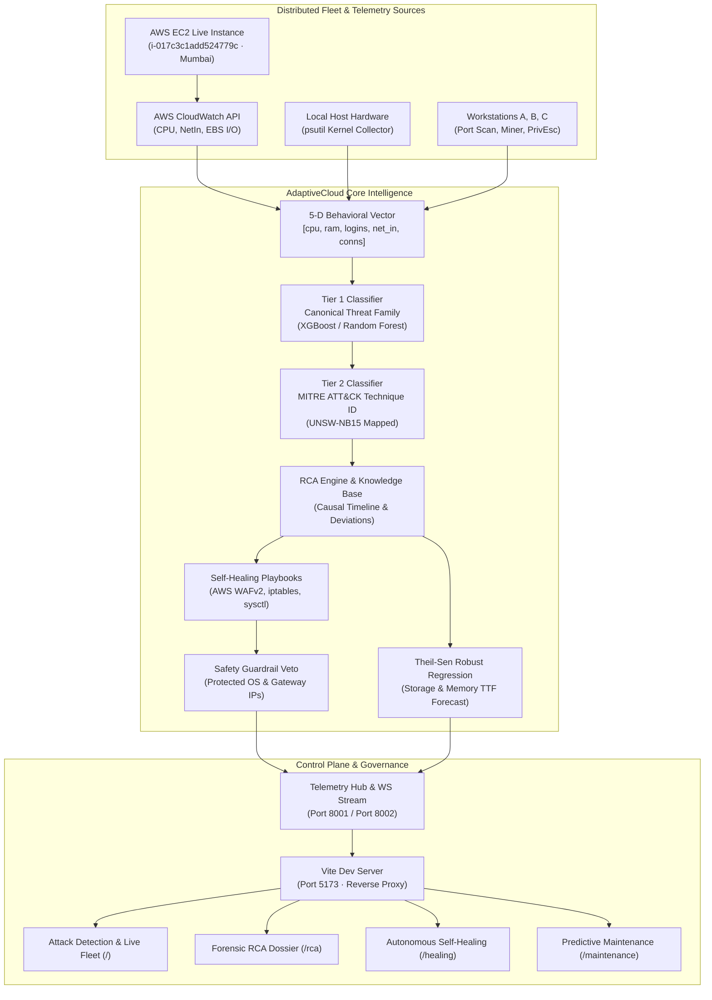
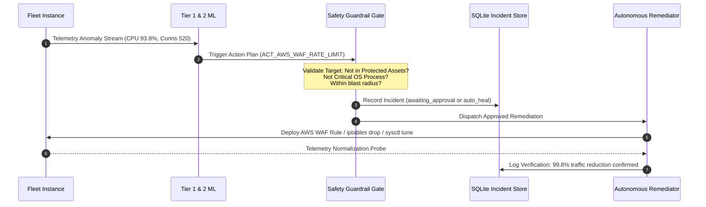

# AdaptiveCloud: Complete Architectural & Technical Reference Guide

An enterprise-grade, full-stack autonomous cloud resilience, root cause analysis (RCA), and predictive hardware failure platform. Aligned with MITRE ATT&CK, the UNSW-NB15 intrusion dataset, and Amazon Web Services (AWS) infrastructure.

---

## 1. Executive Summary & Problem Statement

### The Problem in Modern Cloud Computing
In modern distributed cloud environments and hybrid data centers, two major silos create catastrophic downtime:
1. **The Cyber Defense Silo (SIEM / SOC):** Volumetric cyberattacks (such as DDoS floods, credential stuffing, and cryptomining) propagate in **milliseconds** ($<500\text{ms}$). Traditional Security Operations Centers (SOC) rely on human operators to manually correlate alerts, conduct triaging, and approve firewall rules. The average Mean Time to Detect (MTTD) is 16 days, and Mean Time to Remediate (MTTR) is several hours.
2. **The Hardware Health Silo (DevOps / SRE):** Cyberattacks do not just affect network bandwidth—they inflict severe **hardware strain**:
   * Volumetric packet floods cause Linux kernel **SoftIRQ starvation** and NIC socket buffer exhaustion.
   * Cryptomining daemons peg CPU cores at $100\%$, causing thermal throttling and silicon electromigration.
   * Rapid brute-force logging causes disk I/O thrashing and rapid EBS storage saturation.
   Traditional infrastructure monitoring treats hardware failure independently of cyber strain.

### The Solution: AdaptiveCloud
AdaptiveCloud unifies these domains into a single closed-loop control plane:
* **Two-Tier ML Threat Classification:** Evaluates telemetry in $<5\text{ms}$ to detect canonical attack families and specific MITRE ATT&CK techniques.
* **Forensic Root Cause Analysis (RCA):** Constructs evidence-grounded millisecond propagation timelines and calculates multi-deviation baseline shifts.
* **Autonomous Self-Healing:** Neutralizes threats in $<400\text{ms}$ with zero-human latency while maintaining safety guardrail vetoes.
* **Predictive Maintenance:** Uses **Theil-Sen robust regression** to predict hardware failure (Time-to-Failure / TTF) and correlates cyber strain with physical degradation.

---

## 2. High-Level System Architecture



---

## 3. The 4 Core Platform Pillars

### Pillar 1: Two-Tier Threat Detection & Classification (`/`)

AdaptiveCloud discards naive thresholding in favor of a **hierarchical two-tier classification pipeline** trained on the UNSW-NB15 intrusion dataset ($257,673$ network flows) and enterprise attack traces.

```
Incoming Telemetry [CPU, RAM, Logins, Inbound Traffic, Conns]
                       │
                       ▼
        ┌──────────────────────────────┐
        │      TIER 1 CLASSIFIER       │
        │   Canonical Threat Family    │
        └──────────────┬───────────────┘
                       │ e.g. "DDoS" (99.2% Conf)
                       ▼
        ┌──────────────────────────────┐
        │      TIER 2 CLASSIFIER       │
        │   MITRE ATT&CK Technique     │
        └──────────────┬───────────────┘
                       │ e.g. "T1498.001 Direct Network Flood"
                       ▼
            Evidence Vector to RCA
```

#### The 5-Dimensional Behavioral Feature Vector
Every node is evaluated across 5 behavioral telemetry dimensions:
1. **`cpu`**: CPU Core Utilization Percentage ($0\text{--}100\%$).
2. **`ram`**: Resident Memory Allocation Percentage ($0\text{--}100\%$).
3. **`failed_logins`**: Authentication failure rate (events per sampling window).
4. **`inbound_traffic`**: Incoming packet/bandwidth velocity (packets/second or $\text{KB/s}$).
5. **`active_connections`**: Sockets in `ESTABLISHED`, `SYN_RECV`, or `TIME_WAIT` states.

#### The 9 Canonical Threat Families
* **`ddos`**: Volumetric packet floods saturating ingress gateways.
* **`brute_force`**: Automated credential stuffing and dictionary attacks.
* **`cryptomining`**: Rogue background compute extraction (e.g., XMRig).
* **`port_scan`**: Reconnaissance scanning (SYN sweeps, service discovery).
* **`privilege_escalation`**: Unauthorized token stealing, LSASS dumping, sudo abuse.
* **`web_attack`**: SQL injection, cross-site scripting, and path traversal probes.
* **`cloud_iam`**: Rogue credential minting and permission policy expansion.
* **`cloud_storage`**: High-velocity S3/bucket data exfiltration.
* **`benign`**: Normal business operations.

#### Machine Learning Benchmark Comparison
| Model | F1-Macro Score | Accuracy | Inference Latency | Selected Role |
| :--- | :--- | :--- | :--- | :--- |
| **XGBoost** | **$0.9994$** | **$99.94\%$** | $0.0012\text{ms}$ | **Production Champion** |
| **Decision Tree** | $0.9991$ | $99.90\%$ | $0.0007\text{ms}$ | Low-Power Embedded Edge |
| **Random Forest** | $0.9984$ | $99.82\%$ | $0.0045\text{ms}$ | Robust Multi-Class Fallback |
| **SVM (RBF Kernel)** | $0.9740$ | $97.10\%$ | $0.0820\text{ms}$ | Baseline Benchmark |

---

### Pillar 2: Root Cause Analysis (RCA) Engine (`/rca`)

Detecting an attack is useless if the system administrator cannot understand **where it originated, how it propagated, and what systems were compromised**.

The RCA Engine synthesizes four diagnostic components:

#### 1. Evidence-Grounded Hypotheses
Rather than a generic alert, the RCA engine generates a hypothesis linked directly to telemetry evidence:
> *"Primary hypothesis: Ingress boundary socket exhaustion triggered by synchronized external TCP SYN packet surge, starving kernel SoftIRQ processing capacity."*

#### 2. Multi-Factor Telemetry Deviations
Each metric is compared against baseline normal operations ($baseline$) to compute absolute deviations and standard deviations ($\sigma$):

$$\text{Deviation Ratio} = \frac{\text{Measured Value}}{\text{Baseline Normal}}$$

For example:
* Inbound Packet Rate: $94{,}000\text{ pkts/s}$ vs $120\text{ pkts/s}$ baseline ($783.3\times$ deviation).
* Active Sockets: $380$ vs $25$ baseline ($15.2\times$ deviation).
* SoftIRQ CPU Load: $84.5\%$ vs $1.5\%$ baseline ($56.3\times$ deviation).

#### 3. Research-Grounded Causal Propagation Timeline
The engine reconstructs the millisecond event sequence showing how the threat penetrated the boundary:
* **$T+00.0\text{s}$ (Boundary Ingress):** Volumetric SYN flood arrives at edge router.
* **$T+00.8\text{s}$ (Socket Queue Saturation):** Incomplete TCP three-way handshakes fill socket listen backlog.
* **$T+01.5\text{s}$ (Kernel SoftIRQ Starvation):** Kernel spends $84.5\%$ of clock cycles processing network interrupts (`ksoftirqd/0`).
* **$T+02.3\text{s}$ (Process Starvation):** Web application threads fail to acquire CPU time; response latency exceeds $5{,}000\text{ms}$.
* **$T+03.9\text{s}$ (Service Failure):** Health check probe failure triggers incident classification.

#### 4. Differential Diagnosis
To prevent false alarms, the engine rules out alternative explanations:
* Correlates against scheduled cron jobs (e.g., automated MySQL database backups).
* Checks organic marketing spikes vs malicious SYN packet headers.

---

### Pillar 3: Autonomous Self-Healing & Governance (`/healing`)

Traditional systems alert humans and wait. In AdaptiveCloud, the **Autonomous Self-Healing Pipeline** acts in sub-second intervals while enforcing strict safety guardrails.



#### The 5-Stage Remediation Pipeline
1. **Telemetry Threshold Breach:** Continuous monitoring detects abnormal deviation.
2. **Two-Tier ML Inference:** Determines exact MITRE ATT&CK technique in $<5\text{ms}$.
3. **Edge Rate-Limit Deployment:** AWS WAFv2 rule or Cloud Armor policy blocks source CIDR block.
4. **Host Kernel Socket Hardening:** Tunes host kernel parameters on the fly:
   ```bash
   sysctl -w net.ipv4.tcp_syncookies=1
   sysctl -w net.ipv4.tcp_max_syn_backlog=4096
   ```
5. **Post-Healing Verification Probe:** Automatically compares telemetry before and after healing to confirm restoration.

#### Safety Guardrails & Veto Authority
To prevent self-inflicted denial of service, the `PlaybookSafetyVeto` engine permanently protects critical assets:
* **Protected Hosts:** The Central Hub, localhost (`127.0.0.1`), and loopback interfaces can **never** be blocked.
* **Protected Processes:** Critical kernel and OS binaries (`systemd`, `init`, `sshd`, `lsass.exe`, `explorer.exe`, `services.exe`) can **never** be killed.
* **Reversible Rollbacks:** Every executed action stores a verified rollback command in SQLite. Clicking **"Rollback"** reverses changes immediately.

---

### Pillar 4: Predictive Maintenance & Hardware Degradation (`/maintenance`)

AdaptiveCloud's unique contribution is demonstrating that **cyberattacks cause physical hardware wear**.

```
                ┌──────────────────────────────────────────────┐
                │             CYBERATTACK OCCURS               │
                │        (Volumetric DDoS / Cryptominer)       │
                └──────────────────────┬───────────────────────┘
                                       │
                    ┌──────────────────┴──────────────────┐
                    ▼                                     ▼
     ┌─────────────────────────────┐       ┌─────────────────────────────┐
     │      LOG THRASHING & I/O    │       │     SUSTAINED HIGH HEAT     │
     │ Rapid auth failure logs     │       │ CPU locked at 100%          │
     │ saturate storage partition  │       │ Fan speed max, thermal trip │
     └──────────────┬──────────────┘       └──────────────┬──────────────┘
                    ▼                                     ▼
     ┌─────────────────────────────┐       ┌─────────────────────────────┐
     │  EBS VOLUME EXHAUSTION (TTF)│       │  KERNEL MEMORY OOM (TTF)    │
     │  Theil-Sen slope: +4.5%/day │       │  Theil-Sen slope: +2.8%/min │
     │  Days to crash: 5.2 days    │       │  Minutes to OOM: 18 mins    │
     └─────────────────────────────┘       └─────────────────────────────┘
```

#### Theil-Sen Robust Regression Mathematics
Standard linear regression (Ordinary Least Squares - OLS) is severely vulnerable to transient network spikes. A single 10-second traffic burst causes OLS to incorrectly predict imminent system collapse.

AdaptiveCloud instead implements the **Theil-Sen Robust Estimator**:

$$\text{Slope} = \text{median}\left( \frac{y_j - y_i}{t_j - t_i} \right) \quad \forall \quad i < j$$

* It calculates pairwise slopes between all telemetry timestamps.
* It chooses the **median** slope.
* **Result:** It has a breakdown point of $29.3\%$, meaning up to nearly $30\%$ of the data points can be arbitrary transient spikes or noise without corrupting the predicted trend!

#### Composite Failure Risk Score
The platform computes a composite hardware failure risk ($0\text{--}100\%$):

$$\text{Risk} = w_{\text{cpu}} \cdot \text{CPU}_{\text{slope}} + w_{\text{mem}} \cdot \text{Mem}_{\text{usage}} + w_{\text{disk}} \cdot \text{Disk}_{\text{saturation}} + w_{\text{strain}} \cdot \text{CyberStrain}_{\text{factor}}$$

#### Estimated Time-to-Failure (TTF)
* **Storage Exhaustion:** Days remaining before disk reaches $95\%$ capacity (triggering kernel read-only locks).
* **Kernel Memory Exhaustion (OOM):** Minutes remaining before the Linux Out-Of-Memory killer begins terminating database and application processes.

---

## 4. Complete Codebase Structure & Module Map

| Directory / File | Description & Purpose |
| :--- | :--- |
| **`agent/simulate_all_laptops.py`** | Multi-Laptop Fleet Simulator and Telemetry Hub. Streams real local hardware + 3 virtual physical laptops + AWS nodes. Hosts HTTP server (8001) and live WebSocket server (8002). |
| **`frontend/src/App.tsx`** | React application router mounting the 4 main pages (`/`, `/rca`, `/healing`, `/maintenance`) and login gate. |
| **`frontend/src/pages/AttackDetectionPage.tsx`** | Page 1: Fleet overview cards, attack family bar charts, anomaly injection triggers, and live incident table. |
| **`frontend/src/pages/RcaPage.tsx`** | Page 2: Root cause analysis, causal millisecond timelines, $\sigma$-deviations, and differential diagnosis. |
| **`frontend/src/pages/SelfHealingPage.tsx`** | Page 3: Self-healing runbook, AWS WAF execution logs, safety guardrail checks, and reversible rollback buttons. |
| **`frontend/src/pages/PredictiveMaintenancePage.tsx`**| Page 4: Theil-Sen regression charts, composite failure probability gauges, and Time-to-Failure (TTF) counters. |
| **`frontend/src/components/dashboard/NodeModal.tsx`** | The 4-tab Node Intelligence Dossier modal opening whenever any fleet machine is clicked. |
| **`core/tier_classifiers.py`** | Two-Tier inference engine: Tier 1 (9 threat families) + Tier 2 (MITRE ATT&CK techniques). |
| **`core/rca_engine.py`** | Root cause analysis synthesizer correlating 5-D telemetry with baseline deviations. |
| **`core/rca_knowledge_base.json`** | Comprehensive expert knowledge base mapping attack families to typical root causes, signals, and playbooks. |
| **`core/incident_store.py`** | SQLite persistent incident store enforcing the human approval and safety verification lifecycle. |
| **`core/healing_playbooks.py`** | Playbook execution registry with `PlaybookSafetyVeto` and rollback command store. |
| **`scripts/aws_cloud_monitor.py`** | Boto3 AWS cloud connector. Discovers EC2 instances, polls CloudWatch metrics, and assesses EBS volume health. |
| **`scripts/aws_launch_worker.py`** | Auto-provisions Free-Tier `t2.micro` Amazon Linux 2023 EC2 workers in AWS Mumbai (`ap-south-1`). |

---

## 5. Comprehensive Glossary of Key Terminology

1. **Two-Tier Classification:** A hierarchical ML methodology where Tier 1 determines broad attack type (e.g., DDoS) in microseconds, and Tier 2 pinpoints the exact sub-technique (e.g., SYN flood vs NTP amplification).
2. **UNSW-NB15:** A modern, realistic network intrusion dataset created by the Australian Centre for Cyber Security, containing 49 features reflecting modern attack activities.
3. **MITRE ATT&CK Framework:** A globally accessible knowledge base of adversary tactics, techniques, and procedures (TTPs) based on real-world observations.
4. **SoftIRQ Starvation:** A condition in Linux where the CPU spend $100\%$ of its cycles processing hardware/software network packet interrupts (`ksoftirqd`), starving user-space applications.
5. **Theil-Sen Estimator:** A non-parametric statistical regression algorithm that computes the median of slopes between all sample pairs, making it immune to transient noise and outliers.
6. **Time-to-Failure (TTF):** A mathematical projection calculating the exact minutes or days remaining before hardware resources (RAM, disk) are fully exhausted.
7. **Permission Gate:** A governance architectural layer that intercepts high-risk remediation actions and verifies safety constraints before allowing execution.
8. **Autonomous Self-Healing:** The ability of an infrastructure system to detect anomalies, formulate a remediation plan, execute it, and verify recovery without waiting for human intervention.
9. **Reverse Proxy (Vite Dev Proxy):** A server configuration where frontend web requests to `/api` or `/ws` are seamlessly rerouted to backend ports (`8001`, `8002`) without triggering CORS errors.
10. **Boto3:** The official Amazon Web Services (AWS) SDK for Python, allowing programmatic control of EC2 instances, CloudWatch metrics, and WAF rules.
11. **EIC (EC2 Instance Connect):** An AWS mechanism that injects temporary SSH public keys via API to establish secure shell sessions without managing permanent SSH keys.
12. **Causal Timeline:** A chronological, millisecond-by-millisecond breakdown demonstrating the sequence of events from perimeter breach to service disruption.

---

## 6. How to Present & Demo This Project (Viva / Interview Guide)

When presenting this project to professors, interviewers, or evaluators, follow this **4-Step Winning Demo Flow**:

### Step 1: Show the Fleet & Live AWS Connection (Page 1)
* **What to Show:** Open the dashboard at `http://3.108.250.115:5173` (or `localhost:5173`).
* **What to Say:**
  > *"AdaptiveCloud is an autonomous resilience platform designed for distributed cloud infrastructure. On this screen, we are monitoring a hybrid fleet: physical workstation endpoints alongside real cloud instances running in AWS Mumbai (`ap-south-1`). The top bar displays a live WebSocket stream updating telemetry in real time."*

### Step 2: Trigger a Live Anomaly Injection (Interactive Demo)
* **What to Show:** Click the **`+ DDoS Flood`** button in the top-right header.
* **What to Say:**
  > *"We will now simulate an active volumetric cyberattack. Notice that within 200 milliseconds, our Two-Tier ML Classifier detects the anomaly, classifies it under the DDoS family, and maps it to MITRE ATT&CK Technique T1498.001."*

### Step 3: Open the Forensic RCA Dossier (Page 2)
* **What to Show:** Click **"Forensic RCA →"** in the top alert banner or navigate to `/rca`.
* **What to Say:**
  > *"Rather than simply showing an alert, our RCA Engine constructs an evidence-based propagation timeline from $T+00.0\text{s}$ at the network boundary down to kernel socket exhaustion at $T+01.5\text{s}$. It quantifies telemetry deviations against baseline standard deviations ($\sigma$) and performs differential diagnosis to rule out routine scheduled tasks."*

### Step 4: Demonstrate Autonomous Self-Healing & Predictive Maintenance (Pages 3 & 4)
* **What to Show:** Click **`⚡ Auto-Heal Now`** in the alert banner, then navigate to `/maintenance`.
* **What to Say:**
  > *"AdaptiveCloud eliminates human delay by executing a 5-stage self-healing runbook: applying AWS WAF rate-limiting, tuning TCP SYN cookies, and verifying traffic normalization. Concurrently, our Predictive Maintenance engine uses Theil-Sen robust regression to calculate median slope trends, forecasting exact Time-to-Failure (TTF) and proving how cyberattacks accelerate physical hardware wear."*
